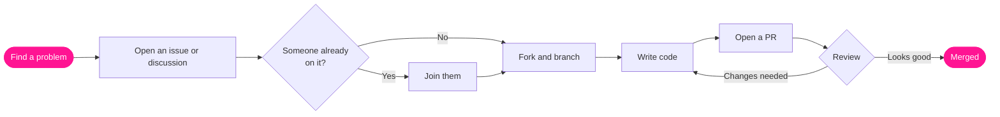

 

 

[About](#about) &nbsp;·&nbsp; [What we build](#what-we-build) &nbsp;·&nbsp; [Stack](#stack) &nbsp;·&nbsp; [How we work](#how-we-work) &nbsp;·&nbsp; [Join](#join)

 

---

## About

**APW Labs** is an advanced open-source research and development collective. It grew out of [AndroidPortWorld](https://github.com/AndroidPortWorld), our Android porting community, and widens that mission well beyond mobile.

We build **production-grade software** across system engineering, cloud architecture, desktop tooling and on-device intelligence. Every project is designed to be shipped, maintained and put on a portfolio. We treat our repositories as real engineering work, not tutorials.

---

## What we build

**Android and system work**
Custom AOSP ROMs, GSIs, kernel hacking, Magisk and KernelSU stuff, and pulling apart OEM apps to port them to other devices. Also cross-platform mobile apps when a project needs them.

**Web and cloud**
Full-stack apps, microservices that have to handle real traffic, REST and gRPC APIs, Docker deployments, and distributed databases.

**Desktop and PC**
Native binaries for Windows, Linux and macOS. Custom GUI toolkits. A lot of Linux CLI and terminal tools, because that's where half of us live anyway.

**Edge AI and embedded**
Running models on-device, quantizing them until they fit, ML pipelines, firmware for small boards, and on-device crypto.

<!-- TODO: add a table of the org's main repos here once you pick which ones to feature -->

---

## Stack

| Area | What we use |
|:--|:--|
| Android |  Jetpack Compose, Room, ADB, Magisk, KernelSU |
| Web and cloud |  |
| Desktop |  JavaFX, Kivy |
| AI and ML |  ONNX, JNI, Chaquopy |

---

## How we work

There are no deadlines here and nobody tells you what to build. Work on a problem as long as it takes. If you vanish for a month, nothing breaks.

Everyone's opinion counts the same. A good idea from someone who joined yesterday beats a weak one from someone who's been around for years. Reviews are about the code, not the person.

We care about clean structure and honest docs. Mark a hack as a hack and write down what you skipped.

And since these repos double as portfolio pieces, we try to make sure your name on a commit means something to the next person who reads it.

### Contributing

1. **Look around.** Browse the repos and open issues until something annoys you enough to fix.
2. **Say what you're doing.** Open an issue or start a discussion first. It saves everyone from duplicate work.
3. **Build it.** Fork, branch, write code.
4. **Get reviewed.** Reviewers push on quality and explain why. Merit decides what gets merged.

Here's the same thing as a picture, including the loop you'll probably hit at review:

> [!TIP]
> Not sure where to start? Open an issue and ask. A half-formed idea is fine.

---

## Join

Porting a ROM, writing a microservice, shipping a desktop tool, squeezing a model onto a phone. There's room for it.

 

 

APW Labs · open source · no deadlines

